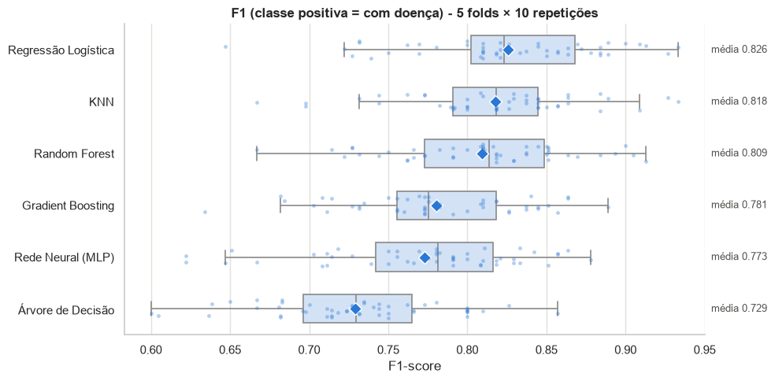

# **Identificação do grupo**

| Nome | Cartão UFRGS |
| :---- | :---- |
| Gabriel Pieruccini Knopp | 00594975 |
| Vítor Santana Feijó | 00588403 |
|  |  |

**Link para o notebook do Google Colab (ou google drive com arquivos do T1):**  
[Google Colab](https://colab.research.google.com/drive/1RlvYrCOHP42hWTWEHPSErE1awk6hvJ6-?usp=sharing) 

# **1\. Definição do problema**

**Título do trabalho:** Detector de Ataques Cardíacos

**Dataset:**  [Health Care Dataset on Heart Attack Possibility](https://www.kaggle.com/datasets/nareshbhat/health-care-data-set-on-heart-attack-possibility)

**Variável alvo/problema a ser resolvido:**  Tendência de Ataque Cardíaco

**Caracterização dos dados**: 303 instâncias no arquivo original (302 após a remoção de 1 instância duplicada) e 13 atributos preditivos, todos utilizados: 5 numéricos (age, trestbps, chol, thalach, oldpeak), 3 binários (sex, fbs, exang), 4 categóricos nominais (cp, restecg, slope, thal) e 1 discreto ordinal (ca). O alvo é binário: 138 pacientes com doença cardíaca (45,7%) e 164 sem doença (54,3%).

# **2\. Preparação dos dados**

Descreva as decisões de preparação que foram necessárias para o dataset escolhido, incluindo:

* Atributos disponíveis e utilizados.  
* Tratamento de valores ausentes e inconsistências, quando aplicável.  
* Codificação e/ou transformação das variáveis.  
* Normalização ou padronização, quando aplicável.  
* Tratamento de desbalanceamento de classes, quando aplicável.  
* Outras decisões de pré-processamento que possam afetar a comparação entre modelos.

### As decisões tomadas foram:

- **Atributos:** os 13 atributos preditivos foram mantidos. Alguns atributos apresentam baixa relevância individual (correlação com o alvo), mas, como a base tem poucos atributos e essas medidas não capturam interações, nenhum atributo foi removido no spot-checking.
- **Valores ausentes e inconsistências:** não há valores ausentes explícitos, mas a comparação registro a registro com a base Cleveland original da UCI mostrou que ca = 4 (4 instâncias) e thal = 0 (2 instâncias) correspondem a valores ausentes ("?") e que a descrição de thal no Kaggle está incorreta (na prática, 1 = defeito fixo, 2 = normal, 3 = defeito reversível). Esses códigos foram convertidos em valores ausentes e imputados pela mediana, calculada apenas nos dados de treino de cada fold (para thal, nominal, a mediana coincide com a moda). Foi removida 1 instância duplicada, artefato/falha da versão do Kaggle. Adicionalmente, a mesma comparação revelou que target = 1 corresponde aos pacientes sem doença (num = 0 na UCI), ao contrário da descrição do Kaggle; por isso, o alvo foi recodificado para 1 = com doença, a classe positiva das métricas. Os outliers (trestbps, chol, thalach e oldpeak) foram mantidos por serem clinicamente plausíveis.
- **Codificação:** não foi necessário converter atributos categóricos em numéricos, pois todos já estão armazenados como números. Porém, cp, restecg, slope e thal são categorias nominais codificadas como inteiros e sem relação monotônica com o alvo; por isso recebem one-hot encoding (13 → 22 colunas), com handle_unknown="ignore" devido a categorias raras (ex.: restecg = 2). Os atributos binários e ca permanecem como estão.
- **Normalização:** as escalas são muito heterogêneas (a amplitude de chol é cerca de 71 vezes a de oldpeak), portanto os atributos numéricos e ca são padronizados (z-score, StandardScaler), o que é essencial para KNN, e ajuda a Regressão Logística e Rede Neural, que dependem do gradiente, a convergirem.
- **Desbalanceamento:** as classes estão quase balanceadas (54% vs 46%, razão ≈ 1,2) e, como consequência, decidimos não aplicar reamostragem, apenas estratificação nas divisões.
- **Outras decisões:** a remoção da duplicata e a recodificação do alvo (regras determinísticas, que não aprendem nada dos dados) são feitas antes da divisão treino/teste; a marcação dos códigos de ausência, também determinística, é aplicada logo após a divisão, igualmente a treino e teste; as etapas que aprendem parâmetros (imputação, codificação e padronização) são encapsuladas em um Pipeline, ajustado somente nos dados de treino de cada fold.

# **3\. Protocolo de avaliação**

Descreva como os modelos serão comparados, preenchendo a tabela abaixo. Adicione observações adicionais necessárias em um parágrafo após a tabela.

| Tarefa | Classificação (binária) |
| :---- | :---- |
| **Métrica principal** | F1-score da classe positiva (com doença). A métrica é adequada para o problema pois, à medida que combina precisão e recall, penaliza tanto deixar de identificar pacientes doentes (falsos negativos) quanto alarmes falsos. |
| **Métricas avaliadas** | F1 (principal), acurácia, precisão, recall e ROC-AUC. |
| **Particionamento dos dados** | Holdout estratificado pelo alvo: 80% para treino (241 instâncias) e 20% para teste (61 instâncias), com random_state = 42. O spot-checking usa apenas o conjunto de treino; o teste fica reservado para a avaliação final no T2. |
| **Estratégia de validação** | Validação cruzada estratificada repetida no conjunto de treino (RepeatedStratifiedKFold): 5 folds × 10 repetições = 50 avaliações por algoritmo, com random_state = 42. Não foi usado nested CV, pois não há otimização de hiperparâmetros no T1. |
| **Tratamento do desbalanceamento de classes** | Não fizemos, visto que as classes são quase balanceadas (54,4% sem doença vs 45,6% com doença no treino; razão ≈ 1,2). Todas as divisões são estratificadas para preservar essa proporção. |
| **Critério de comparação** | Média e desvio padrão do F1 nas 50 avaliações (as mesmas divisões para todos os algoritmos), complementados por boxplots da distribuição do F1. Só usamos as métricas secundárias para auxiliar a interpretação quando as diferenças de F1 são pequenas em relação ao desvio padrão. |
| **Estratégias contra data leakage** | Removemos a duplicata antes da divisão (evitando a mesma instância em treino e teste), realizamos a imputação, one-hot encoding e padronização encapsuladas em um Pipeline do scikit-learn, reajustando apenas nos dados de treino de cada fold, e o conjunto de teste não foi utilizado no T1. |

# **4\. Execução do Spot-Checking**

Liste os algoritmos avaliados e registre, de forma sucinta, as configurações dos hiperparâmetros utilizadas. O objetivo desta etapa é identificar modelos promissores para investigação mais aprofundada no T2.

| Modelo | Configuração utilizada | Motivo da inclusão | Observações |
| :---- | :---- | :---- | :---- |
| KNN | Padrão: n_neighbors = 5, distância euclidiana, pesos uniformes. | Visto em aula e por ser baseado em instâncias e "preguiçoso". | Sensível à escala: depende da padronização e do one-hot. |
| Árvore de Decisão | Padrão: critério Gini, sem poda (max_depth = None), random_state = 42. | Visto em aula e por ser simbólico, não linear e interpretável; referência para os ensembles de árvores. | Sem poda, tende a sobreajustar (alta variância). |
| Regressão Logística | Padrão: regularização L2, C = 1,0, solver lbfgs. | Visto em aula e por ser linear e probabilístico. | Sensível à escala; coeficientes interpretáveis. |
| Rede Neural (MLP) | Padrão (1 camada oculta de 100 neurônios, ReLU, Adam), exceto max_iter = 1000; random_state = 42. | Visto em aula e por ser não linear e possuir aprendizado por gradiente. | max_iter elevado (padrão: 200) para garantir a convergência. |
| Random Forest | Padrão: 100 árvores, max_features = "sqrt", random_state = 42. | Visto em aula e por possuir ensemble por bagging (combina árvores treinadas em amostras diferentes). | Insensível à escala dos atributos. |
| Gradient Boosting | Padrão: 100 estimadores, learning_rate = 0,1, max_depth = 3, random_state = 42. | Visto em aula e na aula de Ciência de Dados, e por possuir ensemble por boosting (sequencial). | Insensível à escala dos atributos. |

Adicione linhas conforme necessário. Não é necessário apresentar aqui todo o código de execução; ele deve estar disponível no notebook.

# **5\. Resultados**

## **5.1 Tabela comparativa**

Apresente os resultados obtidos para os modelos analisados em tabela, com a média e o desvio padrão das métricas analisadas.

| Modelo | F1 | Acurácia | Precisão | Recall | ROC-AUC |
| :---- | :----: | :----: | :----: | :----: | :----: |
| Regressão Logística | 0,826 ± 0,059 | 0,848 ± 0,048 | 0,864 ± 0,068 | 0,798 ± 0,090 | 0,909 ± 0,042 |
| KNN | 0,818 ± 0,055 | 0,837 ± 0,046 | 0,833 ± 0,061 | 0,808 ± 0,076 | 0,872 ± 0,051 |
| Random Forest | 0,809 ± 0,053 | 0,829 ± 0,047 | 0,830 ± 0,074 | 0,796 ± 0,079 | 0,904 ± 0,040 |
| Gradient Boosting | 0,781 ± 0,053 | 0,800 ± 0,047 | 0,786 ± 0,062 | 0,782 ± 0,082 | 0,878 ± 0,045 |
| Rede Neural (MLP) | 0,773 ± 0,062 | 0,797 ± 0,057 | 0,801 ± 0,092 | 0,756 ± 0,085 | 0,867 ± 0,053 |
| Árvore de Decisão | 0,729 ± 0,056 | 0,749 ± 0,053 | 0,725 ± 0,068 | 0,740 ± 0,082 | 0,749 ± 0,053 |

Média ± desvio padrão nas 50 avaliações (5 folds × 10 repetições), ordenado pelo F1. Classe positiva: com doença.

## **5.2 Gráfico comparativo**

Insira um gráfico que permita comparar visualmente o desempenho dos modelos segundo a(s) métrica(s) definida(s) no protocolo.

Distribuição do F1 (classe positiva = com doença) nas 50 avaliações de cada algoritmo; o losango indica a média.

# **6\. Interpretação dos resultados**

Interprete os resultados com foco na comparação entre os modelos e nas evidências que justificam as decisões para o T2. Evite apenas repetir os valores apresentados na tabela.

* **Quais modelos apresentaram resultados mais promissores segundo o protocolo definido?**

Foram eles: a Regressão Logística (0,826), o KNN (0,818) e o Random Forest (0,809).

* **Quais padrões, diferenças ou comportamentos relevantes foram observados entre os modelos?**

Entre os modelos, percebe-se que os não lineares desempenharam, de forma geral, pior do que o único linear, tanto no F1-score quanto na Acurácia, apesar da diferença entre os três primeiros lugares ser menor que os seus desvios padrão, indicando que eles estão praticamente empatados. Podemos destacar também que os modelos mais flexíveis, como a Rede Neural e o Gradient Boosting, não superaram os mais simples, como Regressão Logística e KNN.

* **O que os resultados sugerem sobre o problema e/ou sobre os dados?**

Considerando que, em especial, a Regressão Logística desempenhou tão bem, os resultados sugerem que, provavelmente, esse problema possui uma tendência linear de mapeamento de dados-alvo/fronteira de decisão aproximadamente linear. Além disso, já que temos relativamente poucas instâncias para utilizar, modelos que são mais afetados pela variância (Árvore de Decisão e Rede Neural) acabam sofrendo nos resultados.

# **7\. Seleção dos modelos para o T2**

Relate sobre os modelos selecionados para o T2 e justifique a escolha com base nos resultados do Spot-Checking. A seleção não precisa considerar apenas a maior métrica: aspectos como comportamento observado, características do problema e possibilidade de aprofundamento também podem ser considerados, desde que explicitados.

Selecionamos os modelos **Regressão Logística, KNN e Random Forest** para o T2, especialmente pelo fato de possuírem as três maiores médias de F1 no spot-checking, mas também porque representam modelos inerentemente interpretáveis (Regressão e KNN, apesar do KNN sofrer um pouco pelos dados possuírem alta dimensionalidade) ou derivado do ensemble de modelos inerentemente interpretáveis (Random Forest, apesar de não ser propriamente interpretável) - assim, entendemos que será mais fácil e intuitivo realizar o julgamento e tomada de decisões quando eventualmente precisarmos no segundo trabalho. Além disso, será especialmente interessante realizar a comparação entre um modelo "preguiçoso"/que não constrói um modelo no treinamento e possui 1 hiperparâmetro principal, um modelo linear único com poucos hiperparâmetros e um modelo que é um ensemble de vários outros modelos treinados (árvores) com muitos hiperparâmetros.

# **Uso de IA Generativa**

Ferramentas de Inteligência Artificial Generativa podem ser utilizadas como recurso complementar durante a realização do trabalho, por exemplo, para esclarecer conceitos, sugerir alternativas, auxiliar na identificação de erros ou apoiar a organização do código e do texto. Entretanto, seu uso não substitui a análise e a tomada de decisão pelos estudantes. Todas as decisões metodológicas, implementações, resultados e interpretações apresentadas no trabalho devem ser compreendidas pelos autores, que devem ser capazes de explicar e justificar as escolhas realizadas e os resultados obtidos. **Quando o uso de IA Generativa tiver contribuído de forma relevante para o desenvolvimento do trabalho, isso deve ser informado neste relatório, conforme as orientações da disciplina.**

Utilizamos o Claude Opus 5.5 (Anthropic, 2026), por meio do Claude Code, como apoio: na análise exploratória e na geração de gráficos; na verificação da codificação do dataset do Kaggle em relação à base original da UCI; em sugestões de pré-processamento, métricas e protocolo de validação; na geração do código do notebook; e na estruturação e redação de rascunhos das seções descritivas (como tabelas) deste relatório, revisados pelo grupo. As decisões metodológicas (algoritmos, métrica principal, estratégia de validação e seleção dos modelos para o T2) foram tomadas pelo grupo, e a interpretação dos resultados é de nossa autoria.

## **Resumo dos prompts utilizados**

1. Realizar a análise exploratória dos dados (passo 1 do enunciado) no notebook, tomando como base o enunciado e os notebooks da disciplina e considerando que o projeto seria levado ao Google Colab.
2. Incluir na EDA gráficos que ajudassem a visualizar o que precisaria de pré-processamento.
3. Dividir os dados em treino e teste antes do pré-processamento, para evitar data leakage.
4. Preencher o relatório conforme o andamento, seguindo o template; verificar se os valores de ca e thal eram realmente inválidos, considerando a descrição do Kaggle; remover da EDA as seções consideradas desnecessárias e reorganizar a numeração.
5. Explicar com que evidência foi concluído que o target estava invertido; juntar e remover seções da EDA; iniciar o pré-processamento (normalização, remoção da duplicata e imputação pela mediana), justificando cada decisão; implementar a definição do problema com a abordagem e os algoritmos escolhidos pelo grupo; opinar sobre F1 vs acurácia e sobre o uso de nested cross-validation; executar as repetições do treinamento; consultar o grupo antes de qualquer decisão. Nas perguntas feitas pela IA, o grupo decidiu: divisão treino/teste no pré-processamento, alvo recodificado (1 = com doença), validação 5 folds × 10 repetições, Árvore de Decisão e MLP com max_iter = 1000, e one-hot encoding dos atributos nominais.
6. Completar as referências com as fontes usadas para identificar as inconsistências do dataset do Kaggle.
7. Separar o spot-checking em subseções por modelo, com estatísticas e um breve resumo de cada algoritmo; reorganizar seções do pré-processamento; declarar o uso de IA conforme os documentos da disciplina e apontar usos que não fossem permitidos; incluir a conclusão com os três modelos selecionados pelo grupo e os dados de suporte.
8. Remover travessões; inserir o gráfico comparativo; reordenar as referências; tirar dúvidas conceituais (uso do conjunto de teste na seleção de modelos, marcação vs imputação, ROC-AUC, contagem das classes após a correção do alvo e necessidade de normalização); revisar a integridade dos textos editados pelo grupo e as respostas das seções 6 e 7; discutir o uso de IA no trabalho.
9. Levar as atualizações do relatório em Markdown para o .docx; tirar dúvidas sobre a ordem da marcação dos ausentes, o número de hiperparâmetros dos modelos, a pré-poda nas árvores, outros padrões observados entre os modelos e a terceira pergunta da seção 6; resumir os prompts nesta subseção.
10. Verificar a consistência entre o notebook e o relatório e apontar trechos que ainda precisavam ser preenchidos ou removidos.
11. Verificar novamente a consistência dos arquivos; remover a página de orientações do template; padronizar o nome "Vítor" com acento; registrar as alterações em commits.

# **Referências utilizadas**

Cite as referências utilizadas no desenvolvimento do trabalho.

BHAT, N. Health care: Data set on Heart attack possibility. Kaggle. Disponível em: https://www.kaggle.com/datasets/nareshbhat/health-care-data-set-on-heart-attack-possibility. Acesso em: 20 out. 2026.

JANOSI, A.; STEINBRUNN, W.; PFISTERER, M.; DETRANO, R. Heart Disease [conjunto de dados]. UCI Machine Learning Repository, 1988. DOI: https://doi.org/10.24432/C52P4X. Disponível em: https://archive.ics.uci.edu/dataset/45/heart+disease. Acesso em: 20 out. 2026.

UCI MACHINE LEARNING REPOSITORY. Heart Disease: arquivos processed.cleveland.data (dados originais da base Cleveland, com valores ausentes marcados por "?") e heart-disease.names (documentação dos atributos). Disponível em: https://archive.ics.uci.edu/ml/machine-learning-databases/heart-disease/. Acesso em: 20 out. 2026. Utilizados para verificar a codificação de ca, thal e target na versão do Kaggle.

DETRANO, R. et al. International application of a new probability algorithm for the diagnosis of coronary artery disease. American Journal of Cardiology, v. 64, n. 5, p. 304-310, 1989.

PEDREGOSA, F. et al. Scikit-learn: Machine Learning in Python. Journal of Machine Learning Research, v. 12, p. 2825-2830, 2011.

Anthropic. (2026). Claude (Opus 5.5) [Large language model]. Claude Code. https://www.anthropic.com/claude-code

